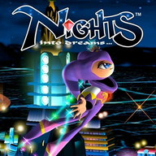

<h1 align=center>nights-nx installer</h1>

A web page that builds the Nintendo Switch package of **NiGHTS into Dreams...** (Xbox Live Arcade, title `58411268`)
for [nights-nx](https://github.com/ChanseyIsTheBest/nights-nx) from the player's own copy, in the browser. Nothing is
uploaded: the game's files never leave the computer.

**Use it here: https://chanseyisthebest.github.io/nights-nx-installer/** (a Chromium browser: Chrome, Edge, ...)

The release NRO carries no game data: none of the game's files and none of its shaders. The page makes the shaders
from the player's files, as nights-nx's native build makes them:

1. **The shaders' containers** (`lib/nights_dump.js`): `default.xex` is decrypted and unpacked (`lib/xex.js`, with
   libmspack's LZX decoder in WebAssembly, `wasm/lzx.*`), and the containers compiled into it are found by reNut's
   `find_shader_headers` rules; the stand-alone ones are `shader/xbox 360/*.wvu` and `*.wpu`. 99 shaders, the same as
   nights-nx's native dump (NiGHTS makes none at runtime).
2. **Renut's translator** (`wasm/renut_hlsl`, XenosRecomp in WebAssembly): each container's HLSL and the numbers of the
   NRO's shader table (masks, vertex inputs, literals).
3. **GLSL for the console**, on a pool of workers (`glsl_worker.js`): `renut_early_alpha.py` (pixel shaders), DXC,
   SPIRV-Cross, `deko3d_glsl.py` and `deko3d_glsl_opt.py`, the Python tools unchanged in
   [Pyodide](https://pyodide.org).
4. **deko3d_glsl.bin** (`lib/package.js`, version 2 of the GLSL package, tag `renut7-bnxglsl1`): the GLSL and the shader
   table, which the NRO reads next to itself.
5. **deko3d_shaders.bin**: every shader variant of `release/variants.txt` (from nights-nx's
   `tools/deko3d_variant_cache.py --export-variants`) plus each shader as it is, compiled by uam in WebAssembly
   (`wasm/uam`, the console's compiler with banjo-nx's flags), so the console compiles nothing at its first start.
6. **nights-nx.zip**, streamed to a download by the service worker (`sw.js`): `switch/nights-nx/` with the NRO,
   `pipeline_list.bin`, the two shader files and `game_root/` (the game's files and the title update's
   `default.xexp`). `renut.toml` is not in it: the NRO writes it at its first start, so an update never overwrites
   the player's settings. Its size is known only at the end (the files below are packed as they stream).

## Packing, H.265 and Opus (2026-11-22)

The user: "help nights into dreams have l4z and zxc in its web installer and rencode video and audio to opus and
h265", "also make sure nights ZXC compresses its videos". The pieces are culdcept-nx-installer's, rr6-nx-installer's
and sa2-nx-ult-installer's; `game.json` says which file gets what:

- **ZXC 7 in 512 KB blocks** (`"zxc"`: the stages' `cse/**/*.ddm`, `afs/*.bin`, the sound banks `afs/*.csb`,
  `afs/*.dat`) and **LZ4 HC 9 in 256 KB blocks** (`"lz4"`: every other file but `default.xex`, `default.xexp`, the
  movies and the music), written as `NAME.lz4b`, which nights-nx reads as `NAME` (`lib/lz4b.js`, `pack_worker.js`,
  `wasm/lz4`, `wasm/zxc`). Measured on every file of the game (2,667 files, 1,093 MB): LZ4 330 MB, ZXC 312 MB; ZXC is
  the smaller on all but the tiny `.csa` files.
- **The movies to H.265** (`"movies"`, the page's first option): the 22 `afs/*.wmv` are ASF with **VC-1 advanced
  profile** video (B pictures) and WMA Pro audio. `movie_worker.js` decodes each with FFmpeg's VC-1 decoder in
  WebAssembly (`wasm/vc1`, built by `wasm/src/vc1/build.sh`) and takes, frame by frame, the picture the game's own
  decoder shows: the newest picture the decoder has given, a movie's first frame drained on its own, and nothing for a
  skipped (one-byte) frame (`lib/movies.js`; nights-nx checked this rule on the PC against the game's decoder, picture
  for picture). Each picture is encoded by the browser's H.265 encoder (WebCodecs) at 35 % of the movie's bitrate, a
  keyframe every 120, and written back into the same ASF file in the frame's place (`lib/asf.js`), which is then packed
  as ZXC blocks (`NAME.wmv.lz4b`). nights-nx plays such a movie on the Switch's video hardware (nxvideo, NVDEC).
- **The music to Opus** (`"audio"`, the page's second option): the 214 `afs/*.adx` (CRI ADX, stereo, 48 kHz) as
  `NAME.adxo` (`lib/adx.js`, `lib/audio.js`, `audio_worker.js`: sa2-nx-ult's ADX decode and resampler, WebCodecs'
  Opus encoder at 128 kbit/s), which nights-nx plays through its ADX decoder hook. With FFmpeg's libopus on a PC
  (nights-nx's `tools/adx_opus_pack.mjs`): 450 MB -> 143 MB, every stream at lag 0.

A browser without an H.265 or Opus encoder, or the option unticked, keeps those files as they are.

## What the player chooses

- **Both packages at once**: the game (`Content/0000000000000000/58411268/000D0000/<package>` of a console's storage)
  and its title update (`000B0000/<package>`, or the `TU_...` file of the console's `Cache` folder), read in place
  (`lib/stfs.js`); or
- **the extracted game folder**, with the update's `default.xexp` beside `default.xex`.

`default.xex` and `default.xexp` are recognised by their SHA-256 (`release/manifest.json`).

## Use

Open https://chanseyisthebest.github.io/nights-nx-installer/ in a Chromium browser. To run it from a copy of this repository instead:

    python serve.py 8193 .

then open http://127.0.0.1:8193/ in a Chromium browser (service-worker downloads, `webkitdirectory`, nested
workers).

## Release files

`release/` is filled by `tools/make_release.py` from a nights-nx **distribution build**. Since nights-nx 1.1.0 (the
ultimate base) that is `tools/build_switch_release.bat` after `tools/renut_release_shaders.py`: the NRO's shader table
holds only numbers (the shaders' hashes, fetch masks and vertex formats, no SPIR-V) and it has no GLSL package, so it
reads every shader from `deko3d_glsl.bin`. (1.0.x's distribution build had an empty table.) With `--reference`, the
manifest also holds the SHA-256 of the two shader files a Node run made (`test/full_node.mjs`), so the page can say
whether its own are identical.

The shader chain follows the nights-nx tree it is built for: `wasm/renut_hlsl.wasm` from its
`app/thirdparty/reblue-XenosRecomp` (`BANJO_NX=<nights-nx> wasm/src/translator/build_wasm_translator.sh`), `py/` from its
`tools/` (deko3d_glsl.py, deko3d_glsl_opt.py and the lists it reads), `release/shader_common.h` from the translator, and
`release/variants.txt` from `tools/deko3d_variant_cache.py --list <a console's pipeline_list.bin> --export-variants`.
1.1.0's: 99 shaders, every one with the native build's interface (constants, inputs and outputs, blocks) and the
native shader table's numbers; 31 of the GLSL texts byte for byte the native ones, the rest differing only by DXC's
version.

## Tests (Node 24, from this folder)

| Test | What it checks |
|---|---|
| `test/full_node.mjs <game folder> <nights-nx> <out>` | the whole build as the page runs it, against nights-nx's native dump, shader table and GLSL |
| `test/chain_node.mjs`, `test/translate_node.mjs`, `test/py_passes_node.mjs`, `test/spirv_cross_node.mjs`, `test/uam_node.mjs` | banjo-nx-installer's checks of the chain's parts |
| `test/browser.html` (with `python serve.py 8193 . --test-files <game>`) | worker.js in a browser, the zip read back |
| `test/pack_node.mjs <game folder> <out> [--link-rest]` | packs the game as the page does (game.json), into a folder to run nights-nx on |
| `test/stfs_node.mjs <package> [<extracted folder>]` | `lib/stfs.js` on a package: every file of the folder found and byte for byte the same |
| `test/pictures_node.mjs <movie.wmv> [<nights-nx log> <movie number>]` | the pictures `lib/movies.js` takes, as hashes, against those nights-nx logged (`nights_wmv_log_hashes`) |
| `test/hevc_node.mjs <movie.wmv> <out.wmv>` | a movie's H.265 copy as the page makes it, with ffmpeg's libx265 for the encoder |

Outputs of the tests (shader files, zips) are game data: never commit or share them.

See NOTICES.md for what comes from where and its licences. GPL-3.0 (LICENSE).
